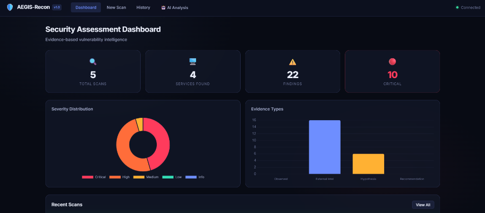
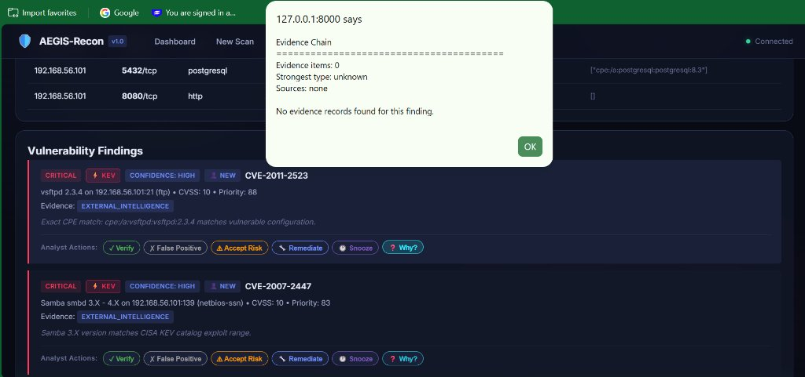
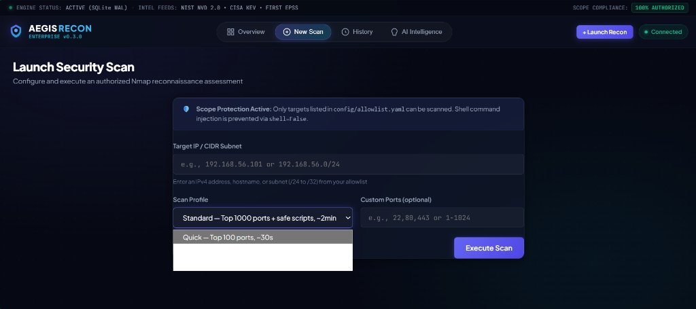
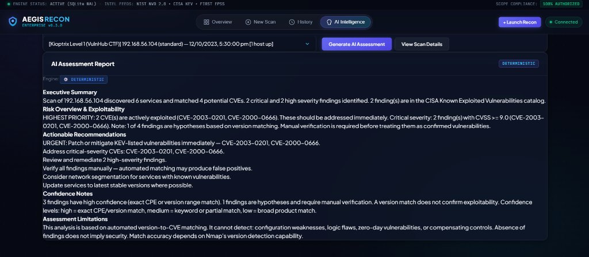
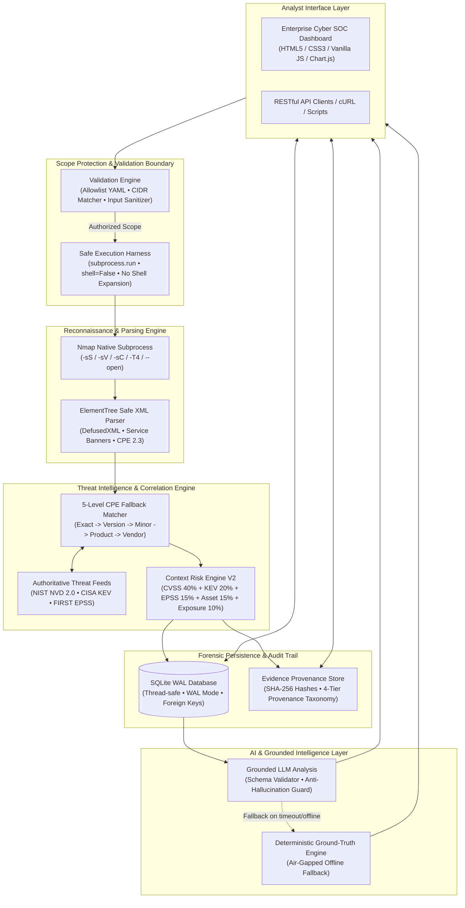

# AEGIS-Recon — Enterprise Vulnerability Intelligence Platform

> **Evidence-based network reconnaissance and threat intelligence platform with explainable vulnerability prioritization (CVSS v3.1, CISA KEV, EPSS), 4-tier cryptographic evidence provenance, and policy-governed allowlist scope protection.**

[](LICENSE)
[](https://python.org)
[](https://fastapi.tiangolo.com)
[](https://nmap.org)
[](https://github.com/PyCQA/bandit)
[](https://github.com/parthkamble4536-ship/AEGIS-Recon/actions)
[](tests/)

---

## 📌 Executive Overview

**AEGIS-Recon** is an industrial-grade, defensive reconnaissance and vulnerability correlation platform built for Security Operations Center (SOC) analysts, penetration testers, and security researchers.

Traditional vulnerability scanners often suffer from high false-positive rates, opaque severity scores, and uncontrolled command execution risks. **AEGIS-Recon addresses these flaws through three core engineering principles:**

1. **Zero-Trust Evidence Provenance**: Every reported finding is backed by an immutable 4-tier evidence chain with SHA-256 cryptographic integrity hashes. Version banner matches are strictly classified as *hypotheses* rather than confirmed exploits.
2. **Transparent Multi-Factor Risk Scoring**: Replaces arbitrary 1–10 scores with a composite, explainable 0–100 risk formula integrating **CVSS v3.1 Base Scores**, **CISA Known Exploited Vulnerabilities (KEV)**, **FIRST EPSS Exploit Probability**, and **Asset Criticality Context**.
3. **Strict Policy-Governed Scope Authorization**: Built with strict defense-in-depth controls (`shell=False`, YAML CIDR allowlist enforcement, and zero raw shell command strings) to mathematically prevent out-of-scope scanning and command injection.

---

## 🖥️ Platform Showcase

| Security Assessment Dashboard (Cyber SOC Matrix) |
|:---:|
|  |
| *Real-time metrics, Target Fleet Matrix, CVSS v3.1 donut severity distribution, and 4-tier evidence model.* |

<br>

| Vulnerability Findings & Analyst Triage | Scope-Protected Scan Execution |
|:---:|:---:|
|  |  |
| *Correlated CVEs, CVSS ratings, CISA KEV tags, and Analyst Actions.* | *CIDR subnet validation, scan profiles, and safe subprocess orchestration.* |

<br>

| AI Threat Intelligence & Grounded Mitigation Guidance |
|:---:|
|  |
| *Structured executive summaries, risk overview cards, actionable remediation steps, and operational boundaries.* |

---

## 🏛️ System Architecture



---

## 🔬 What Makes AEGIS-Recon Different

| Architectural Feature | Traditional Vulnerability Scanners | AEGIS-Recon Enterprise |
|:---|:---|:---|
| **Evidence Model** | Unverified assertions presented as ground truth | **Strict 4-Tier Hierarchy**: `OBSERVED` → `EXTERNAL_INTEL` → `HYPOTHESIS` → `RECOMMENDATION` |
| **Evidence Integrity** | Transient plain-text log files | **Cryptographic Verification**: Every evidence item carries an immutable **SHA-256 hash** |
| **Risk Scoring** | Monolithic, opaque CVSS score only | **Explainable Multi-Factor (0–100)**: CVSS (40%) + CISA KEV (20%) + EPSS (15%) + Asset Context (15%) + Exposure (10%) |
| **Version Correlation** | Naive string matching (high false positives) | **5-Level CPE Fallback Matching** (Exact → Version → Minor → Product → Vendor) |
| **Execution Safety** | Vulnerable shell string concatenations (`shell=True`) | **Strict Invariant**: List-based `subprocess.run(shell=False)` with strict parameter sanitization |
| **Scope Authorization** | Scans arbitrary IPs without validation | **Zero-Bypass Policy Engine**: Evaluates targets against CIDR blocks and hostnames in `allowlist.yaml` |
| **AI Reliability** | Unrestricted LLM prompts prone to hallucinations | **Grounded Dual-Engine**: Schema-enforced prompts with an instant **Deterministic Fallback** |

---

## 🎯 Heterogeneous Benchmark Fleet

To scientifically benchmark correlation accuracy, precision, and recall, AEGIS-Recon is pre-configured and evaluated against 4 standard industry benchmark virtual environments:

| Benchmark Target | Operating System | Network Architecture | Evaluated Vulnerability Vectors |
|:---|:---|:---|:---|
| **Metasploitable 2** (`192.168.56.101`) | Linux 2.6 (Debian/Ubuntu) | Legacy Enterprise Server | vsftpd 2.3.4 Backdoor (`CVE-2011-2523`), Samba MS-RPC (`CVE-2007-2447`), Apache DoS (`CVE-2011-3192`) |
| **Metasploitable 3 Win** (`192.168.56.102`) | Windows Server 2016 x64 | Corporate Active Directory Stack | Microsoft SMB Remote Code Execution, IIS WebDAV, WinRM, GlassFish Enterprise Server |
| **Metasploitable 3 Linux** (`192.168.56.103`) | Ubuntu 14.04 LTS x64 | Modern LAMP Production Stack | ProFTPD Remote Exploitation, Apache Subversion, MySQL Authentication Bypass |
| **Kioptrix Level 1** (`192.168.56.104`) | RedHat Linux 9 | Hardened VulnHub CTF Target | Apache `mod_ssl` OpenSSL buffer overflow, Samba trans2open remote execution |

---

## 🚀 Quick Start Guide

### Option 1: Native Installation (Student & Developer Friendly)

Works out of the box on **Windows**, **macOS** (Intel / Apple Silicon), and **Linux** (Ubuntu, Kali, Debian).

#### Prerequisites:
1. **Python 3.11+** installed (`python --version`)
2. **Nmap** installed and accessible in system PATH:
   * **Windows**: `winget install Insecure.Nmap` (or download from [nmap.org](https://nmap.org/download.html))
   * **macOS**: `brew install nmap`
   * **Linux (Ubuntu / Kali / Debian)**: `sudo apt update && sudo apt install -y nmap`

#### Installation Steps:

```bash
# 1. Clone the repository
git clone https://github.com/parthkamble4536-ship/AEGIS-Recon.git
cd AEGIS-Recon

# 2. Create and activate a virtual environment
# Windows (PowerShell):
python -m venv venv
venv\Scripts\activate

# Linux / macOS:
python3 -m venv venv
source venv/bin/activate

# 3. Install dependencies
pip install --upgrade pip
pip install -r requirements.txt

# 4. (Optional) Pre-seed benchmark fleet evaluation data
python scripts/seed_demo_data.py

# 5. Launch the application
python -m uvicorn app.main:app --host 127.0.0.1 --port 8000 --reload
```

Open your browser (fully compatible with **Microsoft Edge**, **Google Chrome**, **Mozilla Firefox**, and **Apple Safari**) and navigate to:
👉 **[http://127.0.0.1:8000](http://127.0.0.1:8000)**

---

### Option 2: Docker & Docker Compose (Zero-Configuration Setup)

Run the entire application in an isolated, multi-stage, non-root container with Nmap and dependencies pre-installed:

```bash
# Clone the repository
git clone https://github.com/parthkamble4536-ship/AEGIS-Recon.git
cd AEGIS-Recon

# Build and start container in background
docker compose up --build -d

# Check live container health status
docker compose ps
```

Access the dashboard at **[http://127.0.0.1:8000](http://127.0.0.1:8000)**.
To stop the platform:
```bash
docker compose down
```

---

## ⚙️ Configuration & Scope Protection

Scope enforcement is managed strictly via `config/allowlist.yaml`. You can authorize single IP addresses, hostnames, or entire CIDR subnets:

```yaml
# config/allowlist.yaml
targets:
  - ip: "192.168.56.101"
    description: "Metasploitable 2 - Linux 2.6"

  - cidr: "192.168.56.0/24"
    description: "Lab Network Subnet (authorizes all lab VMs from .1 to .254)"

  - ip: "127.0.0.1"
    description: "Localhost loopback testing"

allowed_profiles:
  - quick      # Top 100 ports, fast SYN probe (~30s)
  - standard   # Top 1000 ports + safe version scripts (~2m)
  - thorough   # All ports + OS fingerprinting (~10m)

max_concurrent_scans: 2
```

---

## 📡 REST API Reference

AEGIS-Recon provides a fully documented REST API for programmatic automation and CI/CD security workflows:

| Method | Endpoint | Description |
|:---|:---|:---|
| `GET` | `/api/health` | Service health status and SQLite database connection check. |
| `POST` | `/api/scans` | Initiates an authorized reconnaissance scan against an allowlisted target. |
| `GET` | `/api/scans` | Returns chronological scan history and execution logs. |
| `GET` | `/api/scans/{scan_id}` | Detailed port, protocol, and service fingerprints for a scan. |
| `GET` | `/api/findings/{scan_id}` | Correlated CVE findings, CVSS ratings, and priority scores. |
| `GET` | `/api/findings/{finding_id}/why` | Cryptographic evidence provenance chain and SHA-256 hashes for a finding. |
| `POST` | `/api/findings/{finding_id}/analyst` | Analyst workflow action (`verify`, `false_positive`, `accept_risk`, `remediate`, `snooze`). |
| `GET` | `/api/reports/{scan_id}/analysis` | AI threat assessment or deterministic ground-truth report. |
| `GET` | `/api/reports/{scan_id}/html` | Downloads standalone HTML forensic executive report. |
| `GET` | `/api/reports/{scan_id}/json` | Exports full assessment JSON dataset for SIEM ingestion. |

Interactive OpenAPI documentation is available live at **[http://127.0.0.1:8000/docs](http://127.0.0.1:8000/docs)**.

---

## 🧪 Testing & Verification

The repository includes a comprehensive automated test suite covering unit logic, threat intelligence integration, security boundary invariants, and CI/CD checks:

```bash
# Run all unit tests
pytest tests/ -q --tb=short -m "not integration and not evaluation"

# Run security static analysis (Bandit)
bandit -r app/ -c pyproject.toml -q

# Run Ruff linter and formatting checks
ruff check .
ruff format --check .

# Run test suite with code coverage report
pytest tests/ -q -m "not integration" --cov=app --cov-report=term-missing
```

---

## 🔒 Security & Invariant Guarantees

* **Zero Command Injection (`B602` / `B603`)**: All subprocess calls pass argument arrays directly to `subprocess.run(shell=False)` with absolute binary paths.
* **Scope Enclosure**: Targets that do not match an explicit IP or CIDR block in `config/allowlist.yaml` are rejected with `AllowlistError` before any network socket is opened.
* **Path Traversal Defense**: All file lookups, SQLite connection strings, and XML output paths are sanitized through `pathlib.Path.resolve()` against designated base directories.
* **Deterministic Ground-Truth Fallback**: The intelligence pipeline never halts if an external LLM fails, times out, or is offline — an air-gapped deterministic assessment engine produces 100% reliable baseline reports.

---

## 📜 Responsible Use Policy

AEGIS-Recon is engineered **exclusively for authorized penetration testing, academic defense, and defensive security auditing**. 
Unauthorized reconnaissance against third-party systems without explicit written consent is illegal under the **Computer Fraud and Abuse Act (CFAA)**, the **Indian Information Technology Act 2000 (Section 43/66)**, and international cyber legislation.

Refer to [RESPONSIBLE_USE.md](RESPONSIBLE_USE.md) for full compliance guidelines.

---

## 📄 License

This project is licensed under the **MIT License** — see the [LICENSE](LICENSE) file for details.
