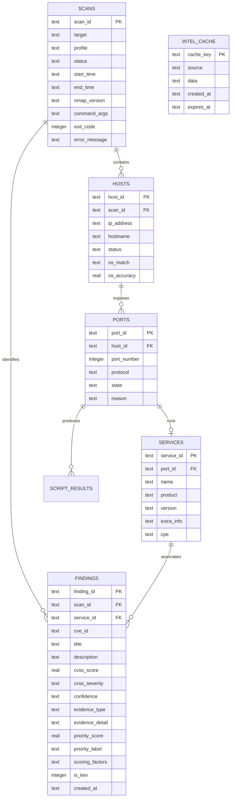

# AEGIS-Recon: Complete Technical System Overview

> **Evidence-Based, AI-Assisted Reconnaissance & Vulnerability Intelligence Platform**  
> *Status: Week 1 & Week 2 Implementation Complete (v0.2.0) | 146 Tests Passing*

---

## 1. Executive Summary

**AEGIS-Recon** is an authorized security assessment and threat intelligence platform designed to replace noisy, unvalidated port scan outputs with structured, explainable, and evidence-grounded vulnerability intelligence.

### The Core Problem in Traditional Reconnaissance
1. **Unsubstantiated Severity Overstatement:** Traditional network scanners frequently report a service version match as a confirmed vulnerability (e.g., flagging Apache 2.2.8 directly as "CRITICAL RCE" without evidence).
2. **Context-Free CVSS Scores:** Raw CVSS scores measure theoretical vulnerability potential, ignoring whether an exploit is actively observed in the wild or whether the service is exposed.
3. **AI Hallucinations in Security:** Using unconstrained LLMs on scan results introduces critical hallucination risks (invented CVEs, fabricated patches, or prompt injection via service banners).
4. **Operational Safety Gaps:** Running scanner commands directly from user input risks shell injection and scanning unauthorized network ranges.

### The AEGIS-Recon Solution
AEGIS-Recon resolves these challenges with a rigorous, pipeline-driven architecture:
- **Strict Evidence Taxonomy:** Every finding is classified into one of four rigid evidence types: `observed`, `external_intelligence`, `hypothesis`, or `recommendation`.
- **Version Match ≠ Confirmed Vulnerability:** Version correlations are treated strictly as hypotheses unless backed by active observation.
- **Explainable 6-Factor Risk Scoring:** Contextual priority (0–100) is decoupled from CVSS, explicitly factoring in CISA Known Exploited Vulnerabilities (KEV), match confidence, evidence weight, public exploit availability, and service exposure.
- **AI Safety & Deterministic Fallback:** AI prompts use strict XML delimiters and schema enforcement. If an LLM hallucinates an untracked CVE or fails validation, the system automatically falls back to an offline, deterministic heuristic engine.
- **Zero-Trust Input Safety:** Strict YAML allowlists, regex validation, frozen scan profiles, and Python `subprocess(..., shell=False)` prevent argument and shell injection.

---

## 2. End-to-End Architecture

```mermaid
flowchart TD
    User([User / Browser / Script]) -->|HTTP / REST| API[FastAPI Application (app.main)]
    
    subgraph Core & Validation
        API --> Val[Input Validation & Allowlist Check (app.core.validation)]
        Val -.->|Rejects Injection & Out-of-Scope| ErrorHandler[HTTP 403/422 Error]
    end

    subgraph Scanner Engine
        Val -->|Validated Target & Profile| Runner[Nmap Subprocess Runner (app.scanner.runner)]
        Runner -->|shell=False, Temp XML| NmapExec[Nmap Executable]
        NmapExec -->|Raw XML| Parser[Nmap XML Parser (app.parser.nmap_xml)]
    end

    subgraph Persistence Layer
        Parser -->|Parsed ScanResult| Repo[SQLite Repository (app.db.repository)]
        Repo <--> DB[(SQLite WAL Database)]
    end

    subgraph Intelligence & Matching
        Repo --> Matcher[CVE Matcher Engine (app.intel.matcher)]
        Matcher <--> Cache[(TTL Cache)]
        Matcher -->|CPE / Range Search| NVD[NVD REST API 2.0 (app.intel.nvd)]
        Matcher -->|Catalog Match| KEV[CISA KEV Catalog (app.intel.kev)]
    end

    subgraph Risk & Priority Engine
        Matcher --> RiskEngine[Explainable Risk Scoring (app.risk.scoring)]
        RiskEngine -->|0-100 Score + Factors| Repo
    end

    subgraph Analysis & Explanation
        Repo --> Analyzer{AI Enabled?}
        Analyzer -->|Yes| LLM[LLM Provider + Schema Validator (app.ai)]
        Analyzer -->|No / Fallback| Det[Deterministic Engine (app.ai.fallback)]
    end

    subgraph Reporting & Dashboard
        LLM --> Builder[Report Builder (app.reports.builder)]
        Det --> Builder
        Builder -->|JSON / Autoescaped HTML| Export([Exported Artifacts])
        Builder -->|REST API| Dashboard[Glassmorphism Web Dashboard]
    end
```

---

## 3. Evidence & Risk Taxonomy

Every piece of information produced by AEGIS-Recon adheres to the following explicit taxonomy:

### Evidence Classification
| Evidence Type | Definition | Example in AEGIS-Recon |
| :--- | :--- | :--- |
| `observed` | Directly seen in raw network interaction or script execution | Port 80/TCP open; HTTP banner `Apache/2.2.8` |
| `external_intelligence` | Correlated from authoritative databases (NVD, CISA KEV) | CVE-2007-6750 listed in CISA KEV with active ransomware link |
| `hypothesis` | Inferred from product/version correlation; **unconfirmed** | Apache 2.2.8 version overlap with CVE-2011-3192 |
| `recommendation` | Remediation or operational guidance without exploitability claim | Upgrade Apache httpd to latest stable release |

> [!IMPORTANT]
> **Cardinal Rule:** A version match is NEVER presented as a confirmed vulnerability. In all reports and API outputs, version-based correlations are tagged as `hypothesis` with an explicit notice that manual verification is required.

---

## 4. Explainable Risk Scoring Engine

Instead of relying solely on CVSS base scores, AEGIS-Recon implements an explainable **6-Factor Composite Priority Score (0–100)**:

```
Priority Score = Min(100, Base CVSS + KEV Status + Match Confidence + Evidence Weight + Exploit Reference + Service Exposure)
```

### Factor Breakdown Table
| Factor | Weight Range | Logic & Description |
| :--- | :--- | :--- |
| **1. Base CVSS Score** | 0.0 – 40.0 pts | Normalized from CVSS v3/v2: `Min(cvss * 4.0, 40.0)`. Provides theoretical baseline without dominating. |
| **2. CISA KEV Status** | 0.0 or 20.0 pts | `+20.0 pts` if the CVE is present in the CISA Known Exploited Vulnerabilities catalog. Confirms real-world weaponization. |
| **3. Match Confidence** | 2.0 – 15.0 pts | `High` (+15 pts, exact CPE or confirmed version range), `Medium` (+8 pts, keyword/product match), `Low` (+2 pts, broad product match). |
| **4. Evidence Type** | 0.0 – 10.0 pts | `observed` (+10 pts), `external_intelligence` (+8 pts), `hypothesis` (+3 pts), `recommendation` (0 pts). |
| **5. Public Exploit Reference** | 0.0 or 5.0 pts | `+5.0 pts` if public exploit URLs (Exploit-DB, GitHub PoCs, PacketStorm) are documented in NVD references. |
| **6. Service Exposure** | 0.0 or 5.0 pts | `+5.0 pts` if running on high-risk/internet-facing ports (21, 22, 23, 25, 80, 443, 445, 3306, 3389, 8080). |

### Priority Classification
- **Critical:** 80.0 – 100.0
- **High:** 60.0 – 79.9
- **Medium:** 40.0 – 59.9
- **Low:** 20.0 – 39.9
- **Informational:** 0.0 – 19.9

Each calculated finding retains a detailed `factors` list explaining exactly how each point was assigned, enabling human analysts to review and validate calculations.

---

## 5. Detailed Component Breakdown

### 5.1 Configuration & Core (`app/core/`, `app/config.py`)
- [`app/config.py`](file:///d:/Projects/AEGIS-Recon/app/config.py): Pydantic-Settings singleton loading configuration from `.env` and system environment variables, including database paths, NVD API keys, rate limits, timeouts, and logging levels.
- [`app/core/validation.py`](file:///d:/Projects/AEGIS-Recon/app/core/validation.py):
  - **Target Validation:** Validates IPv4 addresses, CIDR blocks (strictly `/24` to `/32` to prevent scanning excessive address spaces), and RFC 1123 hostnames.
  - **Shell Injection Filter:** Inspects input for command chaining characters (`;`, `&`, `|`, `` ` ``, `$`, `(`, `)`, `{`, `}`, `<`, `>`, `\`, `"`, `'`, `^`, `%`, `!`, `#`).
  - **Scope Authorization:** Enforces target containment against `config/allowlist.yaml`.
  - **Port & Profile Sanitization:** Validates port syntax (`1-65535`, lists, ranges) and restricts profiles to pre-registered identifiers.
- [`app/core/logging.py`](file:///d:/Projects/AEGIS-Recon/app/core/logging.py): Structured JSON logging powered by `structlog` with automated credential and token redaction (scrubbing API keys, passwords, and bearer tokens).
- [`app/core/errors.py`](file:///d:/Projects/AEGIS-Recon/app/core/errors.py): Typed exception hierarchy rooted at `AegisError` (`ValidationError`, `AllowlistError`, `ScannerError`, `IntelError`, `LLMError`, `DatabaseError`).

### 5.2 Scanner Engine (`app/scanner/`)
- [`app/scanner/profiles.py`](file:///d:/Projects/AEGIS-Recon/app/scanner/profiles.py): Immutable scan profiles (`quick`, `standard`, `thorough`) stored as frozen argument tuples. Users select profile identifiers; raw command line flags are never accepted.
- [`app/scanner/runner.py`](file:///d:/Projects/AEGIS-Recon/app/scanner/runner.py):
  - Subprocess execution with `shell=False`.
  - Outputs directly to secure temporary XML files rather than stdout pipes, preventing memory starvation during large scans.
  - Dual timeouts: Subprocess process-level timeout + Nmap `--host-timeout`.
  - Temporary files cleaned up in `finally:` blocks.

### 5.3 Parser Subsystem (`app/parser/nmap_xml.py`)
- [`app/parser/nmap_xml.py`](file:///d:/Projects/AEGIS-Recon/app/parser/nmap_xml.py): Native Python `xml.etree.ElementTree` parser transforming Nmap XML into strongly-typed dataclasses: `ScanResult`, `HostResult`, `PortResult`, `ServiceInfo`, and `ScriptResult`. Extracts CPE identifiers, service fingerprints, banners, and NSE script outputs without third-party XML library dependencies.

### 5.4 Database Layer (`app/db/`)
- [`app/db/database.py`](file:///d:/Projects/AEGIS-Recon/app/db/database.py): SQLite connection manager configured with **Write-Ahead Logging (WAL)**, foreign key constraints enabled, and busy timeouts.
- [`app/db/models.py`](file:///d:/Projects/AEGIS-Recon/app/db/models.py): Normalized schema defining 7 relational tables: `scans`, `hosts`, `ports`, `services`, `script_results`, `findings`, and `intel_cache`.
- [`app/db/repository.py`](file:///d:/Projects/AEGIS-Recon/app/db/repository.py): Repository pattern with 100% parameterized SQL queries protecting against SQL injection, providing full CRUD operations for scans, services, findings, and cached intelligence.

### 5.5 Threat Intelligence & Matching (`app/intel/`)
- [`app/intel/nvd.py`](file:///d:/Projects/AEGIS-Recon/app/intel/nvd.py): REST client for NVD API 2.0. Supports CPE 2.2 to 2.3 normalization, rate limiting (0.6 req/s unauthenticated, 50 req/s with key), automatic exponential backoff, and pagination.
- [`app/intel/kev.py`](file:///d:/Projects/AEGIS-Recon/app/intel/kev.py): CISA KEV catalog ingestor downloading, caching, and searching the official JSON catalog for known ransomware campaigns and remediation mandates.
- [`app/intel/cache.py`](file:///d:/Projects/AEGIS-Recon/app/intel/cache.py): Persistent TTL-backed cache in SQLite with stale fallback capability: if the NVD API is unreachable, cached results are served with staleness annotations.
- [`app/intel/matcher.py`](file:///d:/Projects/AEGIS-Recon/app/intel/matcher.py): Multi-strategy correlation engine:
  1. *CPE Exact Match* (`confidence: high`)
  2. *CPE Version Range Match* (`confidence: high`)
  3. *Product + Version Keyword Match* (`confidence: medium`)
  4. *Product-Only Match* (`confidence: low`)

### 5.6 AI Analysis & Deterministic Fallback (`app/ai/`)
- [`app/ai/provider.py`](file:///d:/Projects/AEGIS-Recon/app/ai/provider.py): Abstract provider interface for pluggable LLM integrations (Anthropic, OpenAI, local models).
- [`app/ai/prompts.py`](file:///d:/Projects/AEGIS-Recon/app/ai/prompts.py): Guarded system and user prompts utilizing strict XML delimiters (`<SCAN_CONTEXT>`, `<FINDINGS>`, `<OUTPUT_SCHEMA>`). Forbids active command suggestions, hallucination, or treating input banners as execution instructions.
- [`app/ai/validator.py`](file:///d:/Projects/AEGIS-Recon/app/ai/validator.py): Post-generation validation layer:
  - Validates JSON format and required keys (`summary`, `risk_overview`, `recommendations`, `limitations`).
  - **Hallucination Detection:** Detects any CVE IDs in the output not present in the input ground truth and rejects the response.
  - **Dangerous Command Guard:** Rejects text containing offensive commands (`metasploit`, `msfconsole`, `nc -e`, `sudo`, `nmap -...`).
- [`app/ai/fallback.py`](file:///d:/Projects/AEGIS-Recon/app/ai/fallback.py): Deterministic heuristic analysis engine running fully offline without GPU or external API calls, generating consistent summaries, prioritized remediation lists, and limitation notes.

### 5.7 Reporting Subsystem (`app/reports/`)
- [`app/reports/builder.py`](file:///d:/Projects/AEGIS-Recon/app/reports/builder.py): Generates structured JSON reports and standalone HTML reports.
- [`app/reports/templates/report.html`](file:///d:/Projects/AEGIS-Recon/app/reports/templates/report.html): Premium Jinja2 dark-theme HTML report template. Configured with strict HTML autoescaping to eliminate stored XSS vulnerabilities from service banners or CVE descriptions.

### 5.8 FastAPI REST API (`app/main.py`, `app/api/`)
- [`app/main.py`](file:///d:/Projects/AEGIS-Recon/app/main.py): Application factory with lifespan event handling (automated database setup/teardown), CORS middleware, static dashboard file serving, and typed exception handlers mapping internal errors to HTTP 403, 422, 500, or 502 responses.
- [`app/api/health.py`](file:///d:/Projects/AEGIS-Recon/app/api/health.py): `/api/health` providing readiness checks for database, Nmap executable, and cache state.
- [`app/api/scans.py`](file:///d:/Projects/AEGIS-Recon/app/api/scans.py): Endpoints to launch scans (`POST /api/scans`), retrieve scan lists (`GET /api/scans`), and inspect detailed scan records (`GET /api/scans/{scan_id}`).
- [`app/api/findings.py`](file:///d:/Projects/AEGIS-Recon/app/api/findings.py): Endpoints to query findings with filters (`GET /api/findings`) and execute CVE intelligence enrichment (`POST /api/scans/{scan_id}/enrich`).
- [`app/api/reports.py`](file:///d:/Projects/AEGIS-Recon/app/api/reports.py): Endpoints to download JSON or HTML reports (`GET /api/scans/{scan_id}/report`) and trigger AI/deterministic analysis (`POST /api/scans/{scan_id}/analyze`).

### 5.9 Web Dashboard (`web/`)
- Glassmorphism dark-theme user interface built with HTML5, vanilla CSS3, and JavaScript:
  - **Dashboard View:** Real-time KPI statistics, Chart.js severity distribution donut chart, evidence type breakdown bar chart, and recent scans table.
  - **New Scan View:** Pre-validated scan initiation modal with profile selector, target input, and dynamic progress bar.
  - **History View:** Paginated history of all past assessments.
  - **Scan Detail View:** Discovered services table, findings list with risk score progress bars, CISA KEV highlight badges, and report export buttons.

---

## 6. Database Schema



---

## 7. REST API Reference

| Method | Endpoint | Description | Request Body / Parameters |
| :--- | :--- | :--- | :--- |
| `GET` | `/api/health` | System health check (DB, Nmap, Cache) | None |
| `POST` | `/api/scans` | Launch a new validated scan | `{"target": "192.168.56.101", "profile": "quick", "ports": "80,443"}` |
| `GET` | `/api/scans` | List all historical scans | `?limit=50&offset=0` |
| `GET` | `/api/scans/{scan_id}` | Retrieve scan details and services | None |
| `POST` | `/api/scans/{scan_id}/enrich` | Correlate services against NVD & CISA KEV | None |
| `GET` | `/api/scans/{scan_id}/findings` | Retrieve all scored findings for a scan | `?severity=critical&confidence=high` |
| `GET` | `/api/scans/{scan_id}/report` | Download assessment report | `?format=html` or `?format=json` |
| `POST` | `/api/scans/{scan_id}/analyze` | Run AI / deterministic risk analysis | None |
| `GET` | `/api/findings` | Query all findings across all scans | `?cve_id=...&is_kev=true` |

---

## 8. Verification & Test Suite

The codebase maintains **146 comprehensive automated tests** across 6 test modules:

```
============================= test session starts =============================
platform win32 -- Python 3.13.2, pytest-9.1.1, pluggy-1.6.0
rootdir: D:\Projects\AEGIS-Recon
configfile: pyproject.toml
collected 146 items

tests/integration/test_pipeline.py ........                             [  5%]
tests/unit/test_db.py .....................                             [ 19%]
tests/unit/test_parser.py .................                             [ 31%]
tests/unit/test_scanner.py ................                             [ 42%]
tests/unit/test_validation.py ......................................... [ 82%]
tests/unit/test_week2.py ..........................                     [100%]

============================= 146 passed in 6.43s =============================
```

### Test Coverage Highlights
- **Input Validation & Injection Resistance:** 59 unit tests testing IPv4, CIDRs, hostnames, and 19 distinct command-injection strings.
- **Scanner Execution:** 16 tests verifying profile selection, CLI argument isolation, timeout handlers, and temporary file cleanup.
- **XML Parsing:** 17 tests verifying parsing of real Metasploitable 2 scan fixtures, service version extraction, and malformed XML handling.
- **Persistence & Repository:** 21 tests validating CRUD operations, SQLite WAL mode, foreign key integrity, and SQL injection safety.
- **Intelligence & Cache:** 11 tests verifying NVD CPE normalization, rate limiting, KEV ingestion, and TTL cache with stale fallback.
- **Risk Scoring:** 5 tests validating deterministic 6-factor risk calculation and factor explanations.
- **AI Validation & Safety:** 5 tests checking JSON schema parsing, hallucinated CVE rejection, and dangerous pattern blocks.
- **Reporting & XSS:** 3 tests verifying complete HTML/JSON generation and HTML autoescaping against XSS payloads.

---

## 9. Quick Start Guide

### 1. Environment Setup
```powershell
# Navigate to project root
cd d:\Projects\AEGIS-Recon

# Activate Python virtual environment
.\venv\Scripts\Activate.ps1

# Install dependencies (if not already installed)
pip install -r requirements.txt
```

### 2. Configure Allowlist
Edit `config/allowlist.yaml` to ensure only your authorized targets can be scanned:
```yaml
allowlist:
  targets:
    - "192.168.56.101"        # e.g., Metasploitable 2 VM
    - "192.168.56.0/24"       # Host-only test lab subnet
```

### 3. Launch Application
```powershell
# Start Uvicorn ASGI server
python -m uvicorn app.main:app --host 127.0.0.1 --port 8000 --reload
```

### 4. Access Web Interface & API Documentation
- **Interactive Dashboard:** [http://127.0.0.1:8000/](http://127.0.0.1:8000/)
- **Interactive Swagger API Docs:** [http://127.0.0.1:8000/api/docs](http://127.0.0.1:8000/api/docs)
- **ReDoc API Documentation:** [http://127.0.0.1:8000/api/redoc](http://127.0.0.1:8000/api/redoc)

### 5. Running the Full Test Suite
```powershell
.\venv\Scripts\pytest -v
```

---

## 10. Completed Milestones & Future Roadmap

| Phase | Status | Key Deliverables |
| :--- | :--- | :--- |
| **Week 1: Core Foundation** | **COMPLETE** (v0.1.0) | Target validation, allowlist enforcement, Nmap runner, XML parser, SQLite persistence, 120 unit/integration tests. |
| **Week 2: Intelligence & UI** | **COMPLETE** (v0.2.0) | NVD API client, CISA KEV catalog, 6-factor risk scoring, AI prompts + schema validator, deterministic fallback, HTML/JSON reports, glassmorphism dashboard, 26 tests (146 total). |
| **Week 3: CLI & Hardening** | Planned | Standalone CLI tool (`scripts/cli.py`), API rate-limiting middleware, API key authentication. |
| **Week 4: Live AI Integration** | Planned | Direct Anthropic Claude 3.5 Sonnet / Haiku integration with grounded token streaming. |
| **Week 5: Containerization** | Planned | Multi-stage Dockerfile, docker-compose setup with isolated network bridge. |
| **Week 6: Static & Dynamic Security** | Planned | Bandit AST security audits, pip-audit dependency scanner, full OWASP validation. |
| **Week 7: Live Lab Assessment** | Planned | End-to-end automated validation against live Metasploitable 2 testbed. |
| **Week 8: Release & Packaging** | Planned | GitHub Actions CI/CD pipeline, wheel packaging, complete user documentation. |
