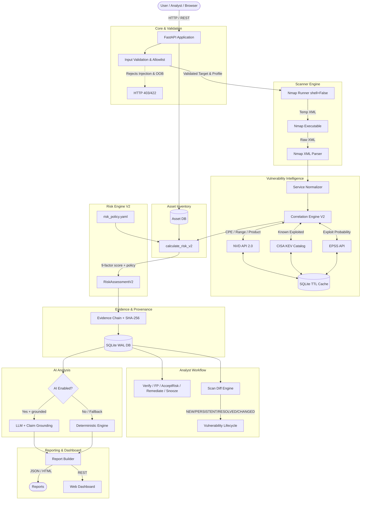
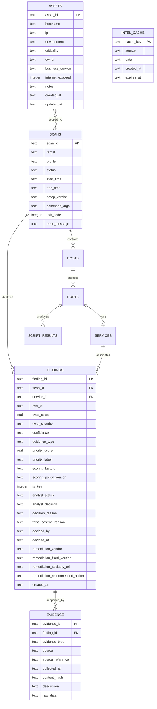

# AEGIS-Recon: Complete Technical System Overview

> **Evidence-Based, AI-Assisted Reconnaissance & Vulnerability Intelligence Platform**
> *Status: Industry-Standard Upgrade Complete (v0.3.0) | 534 Tests Passing*

---

## 1. Executive Summary

**AEGIS-Recon** is an authorized security assessment and threat intelligence platform designed to replace noisy, unvalidated port scan outputs with structured, explainable, and evidence-grounded vulnerability intelligence.

### The Core Problem in Traditional Reconnaissance
1. **Unsubstantiated Severity Overstatement:** Traditional network scanners frequently report a service version match as a confirmed vulnerability (e.g., flagging Apache 2.2.8 directly as "CRITICAL RCE" without evidence).
2. **Context-Free CVSS Scores:** Raw CVSS scores measure theoretical vulnerability potential, ignoring whether an exploit is actively observed in the wild or whether the service is exposed to the internet.
3. **AI Hallucinations in Security:** Using unconstrained LLMs on scan results introduces critical hallucination risks (invented CVEs, fabricated patches, or prompt injection via service banners).
4. **Operational Safety Gaps:** Running scanner commands directly from user input risks shell injection and scanning unauthorized network ranges.
5. **No Analyst Workflow:** Results are dumped without any mechanism for analysts to triage, classify, or track decisions over time.
6. **No Asset Context:** A critical production server and a dev sandbox receive the same priority scores, creating noise and alert fatigue.

### The AEGIS-Recon Solution
AEGIS-Recon resolves these challenges with a rigorous, pipeline-driven architecture:
- **Strict Evidence Taxonomy:** Every finding is classified as `observed`, `external_intelligence`, `hypothesis`, or `recommendation`.
- **Version Match ≠ Confirmed Vulnerability:** Version correlations are always `hypothesis` — never presented as confirmed.
- **9-Factor Explainable Risk Scoring V2:** Contextual priority (0–100) factors in CVSS, CISA KEV, EPSS exploit probability, match confidence, evidence weight, public exploit references, service exposure, asset criticality, and environment.
- **EPSS Integration:** Exploit Prediction Scoring System probability integrated with correct semantics — unavailable EPSS = `None`, NOT `0.0`.
- **Asset Inventory & Context:** Assets carry criticality (LOW/MEDIUM/HIGH/CRITICAL), environment (LAB/DEV/TEST/STAGING/PRODUCTION), and exposure context that directly affects finding priority.
- **Scan Diff & Vulnerability Lifecycle:** Compare scans to track NEW / PERSISTENT / RESOLVED / CHANGED findings over time.
- **Evidence & Provenance Chain:** Every finding carries a full evidence chain with SHA-256 integrity hashes and source attribution.
- **Analyst Workflow:** Analysts can Verify, mark False Positive, Accept Risk, Remediate, or Snooze findings with full audit trail.
- **AI Safety & Deterministic Fallback:** 18 dangerous-pattern blockers, CVE hallucination detection, claim grounding checks, and automatic offline fallback.
- **Zero-Trust Input Safety:** Strict YAML allowlists, regex validation, frozen scan profiles, and `subprocess(..., shell=False)`.
- **Measurable Evaluation:** Precision/Recall/F1 framework with ground truth labels across 4 intentionally vulnerable fixtures.

---

## 2. End-to-End Architecture



---

## 3. Evidence & Risk Taxonomy

Every piece of information produced by AEGIS-Recon adheres to the following explicit taxonomy:

### Evidence Classification
| Evidence Type | Definition | Example |
| :--- | :--- | :--- |
| `observed` | Directly seen in raw network interaction | Port 80/TCP open; HTTP banner `Apache/2.2.8` |
| `external_intelligence` | Correlated from NVD, CISA KEV, EPSS | CVE-2007-6750 in CISA KEV; EPSS=0.94 |
| `hypothesis` | Inferred from product/version correlation — **unconfirmed** | Apache 2.2.8 version overlap with CVE-2011-3192 |
| `recommendation` | Remediation guidance without exploitability claim | Upgrade Apache httpd to latest stable |

> [!IMPORTANT]
> **Cardinal Rule:** A version match is NEVER presented as a confirmed vulnerability. All version-based correlations are tagged as `hypothesis` with explicit notice that manual verification is required.

### Evidence Strength Priority
```
OBSERVED > EXTERNAL_INTELLIGENCE > HYPOTHESIS > RECOMMENDATION
```

---

## 4. Risk Scoring Engine V2

### Formula
```
Priority Score = min(100, CVSS + KEV + EPSS + MatchConfidence + EvidenceStrength + ExploitRef + ServiceExposure + AssetCriticality) × EnvironmentMultiplier
```

### Factor Breakdown
| Factor | Max Points | Logic |
| :--- | :--- | :--- |
| **CVSS Score** | 40 | `min(cvss × 4.0, 40)` |
| **CISA KEV** | +20 | Confirmed active exploitation |
| **EPSS** | +15 | Probability × 15; `None` = 0 contribution (NOT low risk) |
| **Match Confidence** | +15 | HIGH=15, MEDIUM=8, LOW=2 |
| **Evidence Strength** | +10 | OBSERVED=10, EXTERNAL=8, HYPOTHESIS=3, RECOMMENDATION=0 |
| **Public Exploit Ref** | +5 | NVD references include exploit-db, PoC URLs |
| **Service Exposure** | +5 | High-risk ports (21,22,23,25,80,443,445,3306,3389,8080) |
| **Asset Criticality** | +5 | CRITICAL=5, HIGH=3, MEDIUM=1, LOW=0 |

### Environment Multiplier
| Environment | Multiplier |
| :--- | :--- |
| PRODUCTION | × 1.0 |
| STAGING | × 0.9 |
| TEST | × 0.7 |
| DEV | × 0.6 |
| LAB | × 0.5 |

### Priority Labels
- **Critical:** 80–100 | **High:** 60–79 | **Medium:** 40–59 | **Low:** 20–39 | **Informational:** 0–19

> [!NOTE]
> Policy weights are configurable in `configs/risk_policy.yaml`. Every score stores `scoring_policy_version` for reproducibility. Weights have not been experimentally validated as scientifically optimal.

---

## 5. Detailed Component Breakdown

### 5.1 Configuration & Core (`app/core/`, `app/config.py`)
- [`app/config.py`](file:///d:/Projects/AEGIS-Recon/app/config.py): Pydantic-Settings singleton with `.env` + environment variable loading.
- [`app/core/validation.py`](file:///d:/Projects/AEGIS-Recon/app/core/validation.py): IPv4/CIDR/hostname validation, shell injection filter (19 blocked chars), allowlist enforcement, port & profile sanitization.
- [`app/core/logging.py`](file:///d:/Projects/AEGIS-Recon/app/core/logging.py): Structured JSON logging via `structlog` with credential/token redaction.
- [`app/core/errors.py`](file:///d:/Projects/AEGIS-Recon/app/core/errors.py): Typed exception hierarchy rooted at `AegisError`.

### 5.2 Scanner Engine (`app/scanner/`)
- [`app/scanner/profiles.py`](file:///d:/Projects/AEGIS-Recon/app/scanner/profiles.py): Immutable frozen scan profiles (quick/standard/thorough).
- [`app/scanner/runner.py`](file:///d:/Projects/AEGIS-Recon/app/scanner/runner.py): `shell=False` subprocess, temp XML files, dual timeouts, `finally:` cleanup.

### 5.3 Parser (`app/parser/nmap_xml.py`)
- [`app/parser/nmap_xml.py`](file:///d:/Projects/AEGIS-Recon/app/parser/nmap_xml.py): Native `xml.etree.ElementTree` parser → `ParsedScan`, `ParsedHost`, `ParsedService` dataclasses. Extracts CPE, service fingerprints, banners, NSE script outputs.

### 5.4 Database Layer (`app/db/`)
- [`app/db/database.py`](file:///d:/Projects/AEGIS-Recon/app/db/database.py): SQLite WAL mode, FK constraints, busy timeout, thread-local `get_db()` context manager.
- [`app/db/models.py`](file:///d:/Projects/AEGIS-Recon/app/db/models.py): 8+ relational tables: `scans`, `hosts`, `ports`, `services`, `script_results`, `findings`, `intel_cache`, `assets`, `evidence`.
- [`app/db/repository.py`](file:///d:/Projects/AEGIS-Recon/app/db/repository.py): 100% parameterized SQL, full CRUD.

### 5.5 Vulnerability Intelligence (`app/intel/`)
- [`app/intel/nvd.py`](file:///d:/Projects/AEGIS-Recon/app/intel/nvd.py): NVD API 2.0 client, CPE 2.2→2.3 normalization, rate limiting, exponential backoff.
- [`app/intel/kev.py`](file:///d:/Projects/AEGIS-Recon/app/intel/kev.py): CISA KEV catalog ingestor with TTL cache.
- [`app/intel/epss/`](file:///d:/Projects/AEGIS-Recon/app/intel/epss/): EPSS API client returning `EPSSScore` (probability, percentile, source, retrieved_at, expires_at). **Unavailable = `None`, NOT `0.0`.**
- [`app/intel/cache.py`](file:///d:/Projects/AEGIS-Recon/app/intel/cache.py): Persistent SQLite TTL cache with stale-cache fallback.
- [`app/intel/matcher.py`](file:///d:/Projects/AEGIS-Recon/app/intel/matcher.py): `correlate_service()` — 5-level deterministic hierarchy:
  1. Exact CPE → HIGH confidence
  2. CPE version range → HIGH confidence
  3. Vendor + Product + Version → MEDIUM confidence
  4. Product + Version → MEDIUM confidence
  5. Product only → LOW confidence
- [`app/intel/match_result.py`](file:///d:/Projects/AEGIS-Recon/app/intel/match_result.py): `MatchResult` — carries `match_method`, `confidence`, `reason`, `verification_required=True`.
- [`app/intel/models.py`](file:///d:/Projects/AEGIS-Recon/app/intel/models.py): `NormalizedService` dataclass.

### 5.6 Asset Inventory (`app/assets/`)
- [`app/assets/models.py`](file:///d:/Projects/AEGIS-Recon/app/assets/models.py): `Asset` dataclass with `asset_id`, `hostname`, `ip`, `environment`, `criticality`, `owner`, `business_service`, `internet_exposed`, `notes`.
- [`app/assets/repository.py`](file:///d:/Projects/AEGIS-Recon/app/assets/repository.py): CRUD operations for asset inventory.
- [`app/assets/service.py`](file:///d:/Projects/AEGIS-Recon/app/assets/service.py): Business logic for asset management.
- [`app/assets/schemas.py`](file:///d:/Projects/AEGIS-Recon/app/assets/schemas.py): Pydantic schemas for asset REST API.
- REST endpoints: `GET/POST /api/assets`, `GET/PUT/DELETE /api/assets/{id}`

### 5.7 Risk Engine V2 (`app/risk/`)
- [`app/risk/engine.py`](file:///d:/Projects/AEGIS-Recon/app/risk/engine.py): `calculate_risk_v2()` — keyword-only, additive over original `scoring.py`.
- [`app/risk/factors.py`](file:///d:/Projects/AEGIS-Recon/app/risk/factors.py): Individual factor functions (cvss, kev, epss, confidence, evidence, exploit_ref, service_exposure, asset_criticality).
- [`app/risk/models.py`](file:///d:/Projects/AEGIS-Recon/app/risk/models.py): `RiskAssessmentV2`, `RiskPolicyWeights`, `ScoringFactor`.
- [`app/risk/policy.py`](file:///d:/Projects/AEGIS-Recon/app/risk/policy.py): `load_policy()` from `configs/risk_policy.yaml`.
- [`app/risk/explain.py`](file:///d:/Projects/AEGIS-Recon/app/risk/explain.py): Human-readable score explanation formatter.
- [`app/risk/scoring.py`](file:///d:/Projects/AEGIS-Recon/app/risk/scoring.py): Original 6-factor engine — **preserved unchanged**.

### 5.8 Scan Diff & Lifecycle (`app/diff/`)
- [`app/diff/engine.py`](file:///d:/Projects/AEGIS-Recon/app/diff/engine.py): `compare_scans()` — produces `ScanDiff` comparing findings across two scans.
- [`app/diff/models.py`](file:///d:/Projects/AEGIS-Recon/app/diff/models.py): `FindingState` (NEW/PERSISTENT/RESOLVED/CHANGED), `FindingStatus`, `AnalystDecision`, `FalsePositiveReason`, `DiffEntry`, `ScanDiff`.
- [`app/diff/repository.py`](file:///d:/Projects/AEGIS-Recon/app/diff/repository.py): Lifecycle state persistence.
- [`app/diff/remediation.py`](file:///d:/Projects/AEGIS-Recon/app/diff/remediation.py): Remediation guidance CRUD (vendor, fixed version, advisory URL, recommended action).

### 5.9 Evidence & Provenance (`app/evidence/`)
- [`app/evidence/models.py`](file:///d:/Projects/AEGIS-Recon/app/evidence/models.py): `Evidence` (with SHA-256 `content_hash`), `EvidenceChain`, `EvidenceSource`, `EvidenceType`.
- [`app/evidence/repository.py`](file:///d:/Projects/AEGIS-Recon/app/evidence/repository.py): Evidence persistence.
- [`app/evidence/service.py`](file:///d:/Projects/AEGIS-Recon/app/evidence/service.py): Factory functions: `record_nmap_evidence()` → OBSERVED, `record_nvd_evidence()` → EXTERNAL_INTELLIGENCE, `record_kev_evidence()` → EXTERNAL_INTELLIGENCE, `record_epss_evidence()` → EXTERNAL_INTELLIGENCE, `record_version_match_hypothesis()` → HYPOTHESIS.

### 5.10 AI Analysis (`app/ai/`)
- [`app/ai/provider.py`](file:///d:/Projects/AEGIS-Recon/app/ai/provider.py): Abstract LLM provider interface.
- [`app/ai/prompts.py`](file:///d:/Projects/AEGIS-Recon/app/ai/prompts.py): Guarded prompts with XML delimiters (`<SCAN_CONTEXT>`, `<FINDINGS>`, `<OUTPUT_SCHEMA>`).
- [`app/ai/validator.py`](file:///d:/Projects/AEGIS-Recon/app/ai/validator.py): Post-generation validation:
  - JSON schema + required keys (`summary`, `risk_overview`, `recommendations`, `limitations`)
  - **CVE Hallucination Detection:** Rejects CVEs not in input ground truth
  - **Dangerous Pattern Blocking (18 patterns):** `metasploit`, `msfconsole`, `nc -e`, `python -c import`, `powershell -enc`, `/bin/sh`, `eval(`, `exec(`, `__import__`, `sudo`, and more
  - **Claim Grounding:** `check_claim_grounding(claim, allowed_cves)` → SUPPORTED / UNSUPPORTED / UNCHECKED
- [`app/ai/fallback.py`](file:///d:/Projects/AEGIS-Recon/app/ai/fallback.py): Fully offline deterministic analysis engine.

### 5.11 Reporting (`app/reports/`)
- [`app/reports/builder.py`](file:///d:/Projects/AEGIS-Recon/app/reports/builder.py): JSON + HTML report generation. HTML uses strict Jinja2 autoescaping against stored XSS.

### 5.12 REST API (`app/main.py`, `app/api/`)
- [`app/api/health.py`](file:///d:/Projects/AEGIS-Recon/app/api/health.py): `/api/health` — DB, Nmap, cache readiness checks.
- [`app/api/scans.py`](file:///d:/Projects/AEGIS-Recon/app/api/scans.py): Launch scans, list history, get details.
- [`app/api/findings.py`](file:///d:/Projects/AEGIS-Recon/app/api/findings.py): Query findings, run enrichment.
- [`app/api/reports.py`](file:///d:/Projects/AEGIS-Recon/app/api/reports.py): Download JSON/HTML reports, trigger AI analysis.
- [`app/api/assets.py`](file:///d:/Projects/AEGIS-Recon/app/api/assets.py): Asset CRUD REST endpoints.
- [`app/api/diff.py`](file:///d:/Projects/AEGIS-Recon/app/api/diff.py): Scan diff, analyst status/decision/history, remediation endpoints.
- [`app/api/evidence.py`](file:///d:/Projects/AEGIS-Recon/app/api/evidence.py): Evidence chain retrieval, analyst evidence submission, why-flagged explanation.

### 5.13 Web Dashboard (`web/`)
- Glassmorphism dark-theme UI (HTML5, vanilla CSS3, JavaScript):
  - Dashboard KPIs, Chart.js severity distribution, evidence type breakdown
  - Scan initiation modal with profile selector and live progress
  - Paginated scan history
  - Findings detail with risk score bars, CISA KEV badges, EPSS probability
  - **Analyst Action Buttons:** Verify / False Positive / Accept Risk / Remediate / Snooze
  - **Why Flagged modal:** Full evidence chain explanation with source attribution

---

## 6. Database Schema



---

## 7. REST API Reference

| Method | Endpoint | Description |
| :--- | :--- | :--- |
| `GET` | `/api/health` | System health (DB, Nmap, Cache) |
| `POST` | `/api/scans` | Launch a new validated scan |
| `GET` | `/api/scans` | List all scans |
| `GET` | `/api/scans/{id}` | Scan details |
| `POST` | `/api/scans/{id}/enrich` | Correlate against NVD / KEV / EPSS |
| `GET` | `/api/scans/{id}/findings` | All scored findings |
| `GET` | `/api/scans/{id}/report` | Download JSON or HTML report |
| `POST` | `/api/scans/{id}/analyze` | Run AI / deterministic analysis |
| `GET` | `/api/scans/{id}/diff` | Compare to baseline scan |
| `GET` | `/api/findings` | Query findings across all scans |
| `PATCH` | `/api/findings/{id}/status` | Update analyst status |
| `PATCH` | `/api/findings/{id}/decision` | Record formal decision |
| `GET` | `/api/findings/{id}/history` | Audit trail |
| `PATCH` | `/api/findings/{id}/remediation` | Set remediation guidance |
| `GET` | `/api/findings/{id}/evidence` | Full evidence chain |
| `POST` | `/api/findings/{id}/evidence` | Add analyst evidence |
| `GET` | `/api/findings/{id}/why` | Why was this flagged? |
| `GET` | `/api/assets` | List assets |
| `POST` | `/api/assets` | Create asset |
| `GET` | `/api/assets/{id}` | Get asset |
| `PUT` | `/api/assets/{id}` | Update asset |
| `DELETE` | `/api/assets/{id}` | Delete asset |

---

## 8. Verification & Test Suite

**534 automated tests** across 3 categories:

```
=================== 534 passed, 16 deselected in 21.38s ===================

tests/unit/                  462 tests  (standard suite, no integration/eval)
tests/security/ai/            36 tests  (AI safety + dangerous pattern blocking)
tests/evaluation/             36 tests  (correlation accuracy + performance benchmarks)
```

### Test Coverage by Module
| Module | Tests | What Is Tested |
| :--- | :--- | :--- |
| Input Validation | 65 | IPv4, CIDR, hostnames, 19 injection strings |
| Scanner | 13 | Profile selection, CLI isolation, timeouts, temp file cleanup |
| XML Parser | 24 | Real fixtures (4 targets), version extraction, malformed XML |
| Database | 21 | CRUD, WAL mode, FK integrity, SQL injection safety |
| Correlation V2 | 22 | 5-level hierarchy, CPE exact, version range, product-only, malformed CPE |
| EPSS | 16 | Valid response, unknown CVE, timeout, HTTP error, cache hit/expiry, unavailable semantics |
| Assets | 21 | CRUD, criticality/environment enum validation |
| Risk V2 | 36 | All 9 factors, environment multiplier, policy loading, reproducibility |
| Scan Diff | 34 | NEW/PERSISTENT/RESOLVED/CHANGED detection, service diff |
| Evidence | 23 | Chain construction, SHA-256, source attribution, strongest-type ordering |
| Analyst Workflow | 21 | Decisions, status mapping, FP reasons, remediation |
| AI Safety | 36 | 18 dangerous patterns, CVE hallucination (5 cases), schema (6), length (4), grounding (6) |
| Evaluation | 36 | Correlation accuracy (4 fixtures), recall >= 0.5, performance benchmarks |
| Week 2–7 | ~60+ | Integration tests for intelligence, scoring, reports, NVD/KEV |

### Evaluation Fixtures
| Fixture | Target | Known CVEs Tested |
| :--- | :--- | :--- |
| Metasploitable 2 | 192.168.56.101 | CVE-2011-2523 (vsftpd), CVE-2008-5161 (OpenSSH), CVE-2007-2447 (Samba), CVE-2008-0226 (MySQL) |
| Metasploitable 3 Linux | 192.168.56.103 | CVE-2015-3306 (ProFTPD), CVE-2014-3120 (Elasticsearch), CVE-2016-8745 (Tomcat) |
| Metasploitable 3 Windows | 192.168.56.102 | CVE-2016-0792 (Jenkins), CVE-2014-4210 (GlassFish), CVE-2014-3120 (Elasticsearch) |
| Kioptrix Level 1 | 192.168.56.104 | CVE-2002-0082 (Apache), CVE-2003-0201 (Samba), CVE-2002-0656 (OpenSSL), CVE-2001-0817 (OpenSSH) |

---

## 9. Quick Start Guide

### 1. Environment Setup
```powershell
cd d:\Projects\AEGIS-Recon
.\venv\Scripts\Activate.ps1
pip install -r requirements.txt
```

### 2. Configure Allowlist
Edit `config/allowlist.yaml`:
```yaml
allowlist:
  targets:
    - "192.168.56.101"
    - "192.168.56.0/24"
```

### 3. Launch Application
```powershell
python -m uvicorn app.main:app --host 127.0.0.1 --port 8000 --reload
```

### 4. Access
- **Dashboard:** http://127.0.0.1:8000/
- **Swagger API Docs:** http://127.0.0.1:8000/api/docs
- **ReDoc:** http://127.0.0.1:8000/api/redoc

### 5. Run Tests
```powershell
# Standard suite (no integration, no evaluation)
.\venv\Scripts\pytest -m "not integration and not evaluation" -q

# Full suite including evaluation benchmarks
.\venv\Scripts\pytest -m "not integration" -q

# AI safety tests only
.\venv\Scripts\pytest tests\security\ai\ -v

# Evaluation tests only
.\venv\Scripts\pytest tests\evaluation\ -v -m evaluation
```

### 6. Lint & Security Scan
```powershell
.\venv\Scripts\ruff check . --fix
.\venv\Scripts\python -m bandit -r app\ -c pyproject.toml -q
```

---

## 10. Upgrade Milestones

| Phase | Status | Tests | Commit | Key Deliverables |
| :--- | :--- | :--- | :--- | :--- |
| **v0.2.0 Baseline** | ✅ | 289 | `v0.2.0-baseline` | Nmap, NVD, KEV, AI, 6-factor scoring, dashboard |
| **P0 — Baseline Checkpoint** | ✅ | 289 | `68628f8` | Git tag, branch creation, baseline docs |
| **P1 — Correlation Engine V2** | ✅ | 311 | `b4e0e11` | 5-level CPE hierarchy, MatchResult, HIGH/MEDIUM/LOW confidence |
| **P2 — EPSS Intelligence** | ✅ | 327 | `70a98da` | EPSS client, TTL cache, unavailable=None semantics |
| **P3+P4 — Asset Inventory + Risk V2** | ✅ | 384 | `22eae4f` | Asset model, 9-factor risk, policy YAML, environment multiplier |
| **P5 — Scan Diff + Lifecycle** | ✅ | 418 | `7c5cef5` | NEW/PERSISTENT/RESOLVED/CHANGED, analyst decision model |
| **P6 — Evidence & Provenance** | ✅ | 441 | `9f25bb3` | Evidence chain, SHA-256, why-flagged API |
| **P7 — Analyst Workflow** | ✅ | 462 | `01a387d` | Remediation guidance, FP reasons, decision→status mapping |
| **P8 — CI/CD & Hardening** | ✅ | 462 | `883b67c` | GitHub Actions CI, SECURITY.md, CONTRIBUTING.md |
| **P9 — Evaluation + AI Security** | ✅ | 534 | `189b7ad` | 36 AI safety tests, 36 eval tests, claim grounding, 18 dangerous patterns |

**Current: `feature/industry-upgrade` at `189b7ad` — 534 tests passing, 0 failing**

---

## 11. Security Design Principles

> [!IMPORTANT]
> AEGIS-Recon is designed exclusively for **authorized security assessments**. Use only against systems you own or have explicit written authorization to test.

| Principle | Implementation |
| :--- | :--- |
| No shell injection | `subprocess(..., shell=False)`, allowlist enforced |
| No auto-exploitation | Version match = hypothesis only; no exploit execution |
| No credential attacks | No brute-force, no password spraying |
| No stealth/evasion | Standard Nmap profiles only; timing flags fixed |
| No fabrication | AI output validated; CVE hallucinations blocked; benchmarks use real data |
| AI safety | 18 dangerous patterns blocked; claim grounding checked; fallback always available |
| Evidence integrity | SHA-256 content hashes; source attribution on every evidence item |
| Reproducible scoring | `scoring_policy_version` stored per finding; same inputs → same score |
